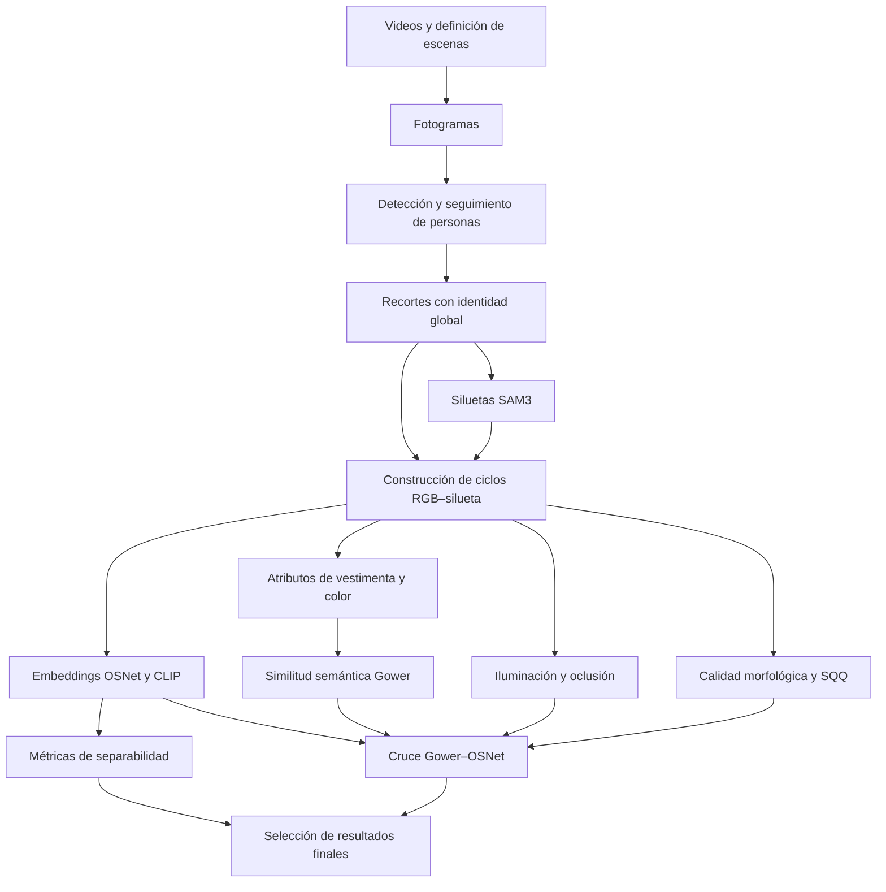

# Corpus multicámara RGB–silueta: construcción y caracterización

Este proyecto reúne el procesamiento de videos, la construcción de secuencias de personas y su caracterización mediante iluminación, oclusión, calidad de silueta, atributos de vestimenta y representaciones visuales profundas. El resultado es un corpus con trazabilidad desde cada ciclo de marcha hasta sus fotogramas de origen, acompañado de indicadores de dificultad para la reidentificación de personas (Re-ID).

El README documenta el trabajo relacionado con el **objetivo 1 de la investigación: construir y caracterizar el corpus multicámara RGB–silueta para estudiar la similitud entre personas y las condiciones que dificultan su reidentificación**. Esta es una descripción operativa inferida de los scripts y documentos locales; el repositorio revisado no contiene el enunciado formal del objetivo de la tesis. Debe usarse ese enunciado oficial cuando se incorpore este texto al documento académico.

Las cifras siguientes se verificaron directamente en los archivos disponibles el **15 de noviembre de 2026**. Los procedimientos se describen a partir del código; esta revisión documental no volvió a ejecutar la extracción de videos ni los modelos.

## Contenido

- [1. Qué se realizó y qué aporta al objetivo 1](#1-qué-se-realizó-y-qué-aporta-al-objetivo-1)
- [2. Estructura del proyecto](#2-estructura-del-proyecto)
- [3. Conceptos e identificadores](#3-conceptos-e-identificadores)
- [4. Flujo de procesamiento y técnicas](#4-flujo-de-procesamiento-y-técnicas)
- [5. Archivos de metadata](#5-archivos-de-metadata)
- [6. Archivos de embeddings](#6-archivos-de-embeddings)
- [7. Resultados observados e interpretación](#7-resultados-observados-e-interpretación)
- [8. Cómo consultar y reproducir el análisis](#8-cómo-consultar-y-reproducir-el-análisis)
- [9. Alcance, limitaciones y trazabilidad](#9-alcance-limitaciones-y-trazabilidad)

## 1. Qué se realizó y qué aporta al objetivo 1

Se implementó una cadena de procesamiento que transforma grabaciones en un conjunto organizado de ciclos de marcha con dos modalidades relacionadas: imágenes RGB, que conservan apariencia y color, y siluetas binarias, que representan la forma corporal a lo largo del tiempo.

La caracterización agrega información en cuatro niveles: fotograma, secuencia, identidad y conjunto de datos. Esto permite localizar ejemplos difíciles, comparar condiciones de captura y estudiar si personas con ropa semejante también resultan cercanas en un espacio de características visuales.

| Componente del trabajo | Evidencia disponible | Contribución al objetivo 1 |
|---|---|---|
| Preparación de videos y seguimiento | Scripts `1` a `7`; carpetas `inputs/` y `transforms/` | Obtener recortes de personas y conservar su procedencia temporal y de cámara. |
| Segmentación y ciclos de marcha | Script `8`, script `9a`, RGB, siluetas y metadatos de generación | Formar unidades temporales RGB–silueta comparables y trazables. |
| Caracterización de condiciones | Iluminación, oclusión y calidad de silueta | Cuantificar variación de captura y confiabilidad de las secuencias. |
| Caracterización de apariencia | Atributos por secuencia e identidad, distancias de Gower | Medir semejanza de ropa, colores y mochila entre personas diferentes. |
| Caracterización mediante modelos | Embeddings OSNet y CLIP, métricas intra/interidentidad | Describir separabilidad visual con representaciones preentrenadas. |
| Integración de evidencias | Cruce Gower–OSNet y exportación de resultados finales | Seleccionar pares de alta ambigüedad y estudiar su contexto. |
| Comparación con referencias | Adaptadores para MARS, iLIDS-VID, CASIA-B y Gait3D | Facilitar análisis con formatos compatibles. Los resúmenes RGB locales incluyen MARS e iLIDS-VID. |

El inventario principal contiene **74 identidades**, **20 escenas** (`S01`–`S20`), **6 cámaras** (`c001`–`c006`), **10 672 ciclos** y **151 886 registros de fotogramas**. El número de cámaras describe el conjunto completo; no implica que cada persona aparezca en todas ellas. Los registros de fotogramas tienen correspondencia RGB–silueta en el manifiesto; estas cifras no constituyen una auditoría de integridad de todos los archivos de imagen.

## 2. Estructura del proyecto

```text
result1/
├── README.md                         Guía general del trabajo y sus resultados
├── pipeline_csv_flow.md              Diagrama y descripción previa del flujo de CSV
├── resumen_presentacion_ppt.md        Resumen narrativo para presentación
├── inputs/
│   ├── raw_videos/                    Grabaciones y tablas de entrada
│   ├── scenes/                        Escenas extraídas
│   └── scenes_backup/                 Respaldo de escenas
├── transforms/
│   ├── frames/                        Fotogramas de las escenas
│   ├── detections/                    Detecciones de personas
│   ├── tracking/                      Resultados de seguimiento
│   ├── format_tracks/                 Trayectorias en formato normalizado
│   ├── vis_tracks/                    Inspección visual del seguimiento
│   ├── annotations/                   Anotaciones de entrada para los recortes
│   ├── gt_crops/                      Recortes e información de identidad/GT
│   └── silhouettes/                   Máscaras de las personas
├── dataset/
│   └── output/                       Corpus y resultados documentados aquí
│       ├── rgb/                      Imágenes por identidad, escena, cámara y ciclo
│       ├── silhouette/               Siluetas con organización correspondiente
│       ├── metadata/
│       │   ├── 01_dataset_generation/
│       │   ├── 02_illumination/
│       │   ├── 03_occlusion/
│       │   ├── 04_cloths_color/
│       │   ├── 05_silhouette_quality/
│       │   ├── 06_gower_similarity/
│       │   ├── 07_final_analysis/
│       │   └── 08_final_paper_metrics/
│       └── embeddings/
│           ├── 01_extracted_embeddings/
│           └── 02_embedding_metrics/
├── outputs/                          Otra raíz de resultados existente
│   ├── metadata/                     No confundir con dataset/output/metadata
│   ├── reports/
│   ├── rgb/
│   └── silhouette/
├── src/
│   ├── 1_...py a 17_...py             Scripts del pipeline
│   ├── notebooks/                    EDA y visualizaciones
│   ├── models/                       Pesos locales de YOLO y OSNet
│   ├── configs/                      Configuraciones de detección/seguimiento
│   ├── mmtrack/                      Código de seguimiento utilizado por el proyecto
│   ├── sam3/                         Código de segmentación SAM3
│   └── backup/                       Versiones previas de scripts
└── dataset_17062026.zip               Archivo comprimido existente
```

La raíz de resultados de este README es **`dataset/output/`**. Las carpetas `outputs/`, los respaldos y el ZIP existen, pero su equivalencia con el corpus actual no se verificó. Los directorios numerados de metadatos representan etapas lógicas; algunas etapas pueden ejecutarse de forma independiente una vez disponibles sus entradas.

## 3. Conceptos e identificadores

- **Re-ID:** reconocer a la misma persona en observaciones diferentes, especialmente entre cámaras.
- **Tracklet:** tramo de seguimiento de una persona dentro de una cámara. Su identificador local no equivale automáticamente a una identidad global.
- **Identidad global (`person_global_id`):** identificador que relaciona observaciones de una persona. El código de análisis normaliza variantes como `ID0000` y `0` para cruzar tablas.
- **Escena (`scene_id`):** segmento de captura identificado como `S01`, `S02`, etc.
- **Ciclo de marcha:** segmento temporal delimitado usando periodicidad de siluetas. En el corpus propio se usa como secuencia de análisis.
- **`sequence_id` / `cycle_id`:** clave de secuencia. Por ejemplo, `S01_c001_ID0000_cyc0001` identifica escena, cámara, persona y ciclo.
- **Embedding:** vector numérico que resume la apariencia de una imagen o secuencia. Aquí se almacenan vectores de 512 componentes.
- **Intraclase:** comparación de secuencias de la misma identidad. **Interclase:** comparación de identidades diferentes.
- **Negativo difícil:** observación de otra identidad que presenta alta similitud con la consulta según el modelo y el umbral utilizados.

Las tablas de secuencias se relacionan por `sequence_id`. Para combinar tablas de fotogramas debe comprobarse la clave compuesta, normalmente `sequence_id` y `frame_number`; `frame_number` solo no es único en el corpus. Las tablas de pares usan `person_global_id_x` y `person_global_id_y`, además de `identity_x` e `identity_y`. El consolidado actual de vestimenta agrupa por identidad; no contiene una columna `capture_session_id`.

## 4. Flujo de procesamiento y técnicas



### 4.1. De los videos a los recortes identificados

| Script en `src/` | Función |
|---|---|
| `1_raw_videos_to_scenes.py` | Extraer segmentos de interés de las grabaciones según la definición de entrada. |
| `2_scenes_to_frames.py` | Convertir escenas en fotogramas, con opciones de muestreo temporal. |
| `3_person_detection_from_frames.py` | Detectar personas con Ultralytics YOLO; existen pesos locales `yolo11m.pt` y `yolo11l.pt`. |
| `4_detections_to_tracking.py` | Adaptar detecciones y ejecutar seguimiento con MMTracking y una configuración seleccionada. |
| `5_format_tracks.py` | Normalizar la salida de trayectorias para las etapas posteriores. |
| `6_visualize_tracks.py` | Dibujar trayectorias para su inspección. |
| `7_extract_image_crops.py` | Extraer recortes usando trayectorias y anotaciones; conservar identidad global y cajas delimitadoras. |
| `8_crops_to_silhouettes.py` | Segmentar personas con SAM3 y guardar máscaras binarias. |

El seguimiento mantiene continuidad dentro de una cámara. La extracción utiliza anotaciones para relacionar las observaciones con identidades globales; por ello, la calidad de esa correspondencia es esencial. La presencia de estos scripts documenta el procedimiento implementado, pero no identifica por sí sola la configuración exacta de todas las ejecuciones históricas.

### 4.2. Construcción de ciclos de marcha

`9a_generate_dataset.py` relaciona recortes RGB y siluetas, divide los tramos según continuidad temporal y forma ciclos **no solapados**. La silueta se transforma en una señal de área de primer plano: para cada fotograma se cuentan los píxeles de la persona. La autocorrelación de esa señal permite estimar repetición temporal y un periodo de paso; el ciclo completo se aproxima como dos periodos de paso.

El script registra periodicidad, duración estimada, límites del ciclo, huecos temporales y dimensiones de las cajas. Admite una alternativa de ventanas basadas en el periodo cuando no consigue delimitar ciclos mediante picos de fase. En los resultados actuales, **10 196 ciclos** usan `foreground_sum_autocorrelation_phase_peaks` y **476** usan `foreground_sum_autocorrelation_period_window_fallback`. También quedan registrados **684 tracklets omitidos** y sus motivos.

La estructura materializada prevista es `rgb/IDxxxx/Sxx/cxxx/cycleNNNN/` y su equivalente bajo `silhouette/`. Los CSV conservan tanto rutas de origen como rutas de salida.

Los adaptadores `9b`, `9c`, `9d` y `9e` generan manifiestos compatibles para MARS, iLIDS-VID, CASIA-B y Gait3D, respectivamente. Los tracklets de conjuntos externos no deben interpretarse automáticamente como ciclos delimitados con el mismo procedimiento del corpus propio.

### 4.3. Iluminación con luminancia y calibración común

`10a_label_sequence_illumination.py` calcula luminancia de las imágenes RGB mediante `Y = 0.299R + 0.587G + 0.114B` y agrega estadísticas por secuencia. `illum_y_mean` describe luminancia media; `illum_y_std` y `illum_y_cv` describen variación temporal.

`10b_build_common_illumination_thresholds.py` calibra umbrales con una muestra equilibrada entre conjuntos. El JSON guardado contiene **600 secuencias por conjunto** —propio, iLIDS y MARS—, **1 800 en total**, con semilla **42**. Los percentiles son **P25 = 95.2136**, **P50 = 112.5784** y **P75 = 132.2627**. Estos cortes permiten asignar cuatro niveles ordinales comparables usando la misma escala operativa. No representan una medición física en lux.

### 4.4. Oclusión mediante puntos corporales y superficie visible

`11a_label_sequence_occlusion_gilroy.py` implementa el procedimiento descrito en su cabecera como basado en Gilroy: Keypoint R-CNN de Detectron2 estima 17 puntos corporales COCO; reglas anatómicas los agrupan en partes del cuerpo y ponderan la superficie corporal 2D visible. La estimación se calcula como `occlusion_pct = 100 × (1 − BSA_visible / 99)`.

Los resultados guardan visibilidad, estado de detección, regiones visibles/ocultas y estadísticas agregadas. Los umbrales registrados son 40 % y 80 %, con categorías `baja`, `parcial`, `alta` y `desconocida` si no hay evidencia válida. Se trata de una estimación dependiente del detector de pose: una parte no detectada también puede deberse a baja resolución o errores de pose.

Los scripts `11b_consolidate_shards_mars.py` y `11c_consolidate_shards_my_dataset.py` consolidan particiones de ejecución. Los archivos `shard_0_3`, `shard_1_3` y `shard_2_3` son tres partes del procesamiento, no conjuntos adicionales.

### 4.5. Vestimenta, mochila y colores

`12_label_cloths_color.py` selecciona varios fotogramas representativos, considerando información de calidad y oclusión cuando está disponible. Separa dos procedimientos:

1. Preanotación semántica de tipo de prenda superior, tipo de prenda inferior y mochila con un modelo multimodal. El CSV actual registra `openai_multiframe:gpt-4.1-mini` en **10 668 secuencias** y `openai_error` en **4**.
2. Estimación de colores superior e inferior mediante regiones de la persona y reglas HSV sobre la máscara. Se guardan etiqueta, familia cromática, confianza y consenso temporal.

Después se consolidan atributos por secuencia y por identidad mediante consenso. Se preservan desconocidos como `unknown`, se admiten correcciones y se genera una lista para revisión. Las **742 filas** del archivo de revisión indican casos que requieren inspección; no prueban que esa revisión humana ya se haya completado. Los atributos son anotaciones semiautomáticas, no verdad de referencia validada automáticamente.

### 4.6. Calidad de silueta: morfología y SQQ

`13_calculate_silhouette_quality.py` combina controles morfológicos —área, componentes conectados, proporción del componente principal, contacto con bordes y validez— con la estimación temporal SQQ que el código atribuye a Liu. El reporte identifica el método como **Liu SQQ + controles morfológicos QAGait**.

Para SQQ se construye una matriz de autocorrelación por ventana y se usan sus autovalores para separar componentes de señal y ruido. El código calcula `sqq_raw = sigma_signal2 − sigma_noise2` y `sqq_quality_ratio = sigma_signal2 / (sigma_signal2 + sigma_noise2 + epsilon)`. El valor bruto y la razón normalizada tienen escalas distintas. La columna agregada actual es **`sil_quality_mean`**; la fracción de ventanas degradadas es **`sil_degraded_ratio`** y la validez morfológica se resume en **`sil_valid_ratio`**.

El reporte conserva ventana Hamming, umbral de componente conectado 0.95 y umbral de degradación 0.5. La comparación con plantillas está disponible en el código, pero el reporte actual indica `template_dir: None`; no debe describirse como una validación por plantillas ejecutada.

### 4.7. Embeddings RGB con OSNet y CLIP

`14a_extract_rgb_embeddings.py` obtiene hasta **12 fotogramas equidistantes** por secuencia como configuración predeterminada. Cada vector se normaliza en L2; luego se promedian los vectores y el promedio vuelve a normalizarse. La salida resume apariencia de la secuencia, sin modelar explícitamente el orden de la marcha.

- **OSNet:** arquitectura `osnet_ain_x1_0`, vector de 512 dimensiones. El código exige un checkpoint Re-ID; existe localmente `src/models/osnet_ain_x1_0_msmt17.pth`. El preprocesamiento redimensiona a 128 × 256 píxeles y aplica normalización de canales.
- **CLIP:** codificador visual `ViT-B/32`, vector de 512 dimensiones y preprocesamiento provisto por la biblioteca CLIP.

El extractor dispone de `raw_uniform` y `controlled_occlusion`. La segunda opción usa oclusión por fotograma y, si existe, validez morfológica. El CSV no guarda el modo seleccionado: no puede deducirse únicamente del nombre del archivo. `14b_patch_embeddings_metadata.py` es una utilidad para reparar identificadores de persona/cámara de salidas anteriores; no vuelve a calcular los vectores.

### 4.8. Métricas visuales y comparación entre conjuntos

`15_calculate_embedding_metrics.py` calcula distancias coseno entre secuencias. Para vectores normalizados, `sim(x,y) = x·y` y `d(x,y) = 1 − sim(x,y)`. A partir de las identidades distingue pares intra e interclase, y repite parte del cálculo restringiendo a cámaras diferentes.

La razón `inter_intra_distance_ratio` es la distancia media interclase dividida por la intraclase. `crosscam_separability_ratio` aplica la misma idea entre cámaras diferentes. Valores próximos a 1 indican menor margen medio; no son porcentajes de acierto.

También se obtienen distancias al negativo más cercano, proporción de negativos entre los vecinos top-1/5/10 y prototipos de identidad. En este script el prototipo promedia secuencias por identidad; **el balance por cámara se realiza en el script 17**, descrito más abajo.

El umbral de negativos difíciles se calibra mediante P90 de similitudes interclase, tomando muestras equilibradas por conjunto, con semilla 42 y límite predeterminado de 100 000 pares por conjunto. Cada modelo tiene su propio umbral. El listado exportado conserva por defecto hasta cinco negativos por consulta y es **direccional**: `A → B` y `B → A` pueden aparecer. Su tamaño no equivale al total de pares interclase difíciles usado para calcular `hard_negative_rate`.

### 4.9. Gower y cruce de ambigüedad

`16_calculate_gower_similarity.py` compara cinco atributos nominales con igual peso: tipo y color de prenda superior, tipo y color de prenda inferior, y mochila. Para este caso, la similitud de Gower es el número de coincidencias dividido por el número de atributos conocidos en ambas identidades; la distancia es `1 − similitud`. Los desconocidos no cuentan como coincidencias ni discrepancias.

Con 74 identidades hay `74 × 73 / 2 = 2 701` pares únicos. El análisis conserva el número de atributos comparables. El cruce final exige al menos cuatro para considerar fiable la comparación semántica.

`17_cross_gower_osnet.py` combina estas comparaciones con embeddings y contexto. Primero promedia secuencias de cada persona dentro de cada cámara, normaliza ese prototipo y luego promedia los prototipos de cámara con el mismo peso. Así se reduce la influencia de cámaras con más secuencias. Calcula similitud OSNet, similitud CLIP y comparaciones OSNet entre cámaras diferentes, además de unir iluminación, oclusión y calidad por identidad.

La clasificación usa `Gower ≥ max(P90_Gower, 0.80)` para similitud semántica alta y `OSNet ≥ P90_OSNet` para similitud visual alta. Estos percentiles se calculan **sobre los pares del corpus analizado**; son distintos de la calibración común entre conjuntos del script 15.

| Etiqueta almacenada en `ambiguity_quadrant` | Condición | Lectura operativa |
|---|---|---|
| `ambiguedad_confirmada` | Semántica alta y visual alta | Coinciden atributos y los prototipos OSNet son cercanos. |
| `ambiguedad_visual_no_explicada` | Semántica baja y visual alta | La cercanía visual no queda explicada por esos cinco atributos. |
| `semejanza_semantica_controlable` | Semántica alta y visual baja | Hay semejanza de vestimenta con mayor separación según OSNet. |
| `baja_ambiguedad` | Semántica baja y visual baja | El par queda fuera de ambas regiones de alta similitud. |
| `incompleto` | Falta similitud o hay menos de cuatro atributos comparables | Evidencia insuficiente para clasificar. |

“Confirmada” es el nombre operativo de una coincidencia de criterios. No demuestra un error de identificación en un protocolo query/gallery ni valida por sí sola una causa ambiental.

## 5. Archivos de metadata

Todas las rutas de esta sección son relativas a **`dataset/output/metadata/`**. Las cantidades son filas de datos, sin encabezado. Los alias y copias se cuentan como archivos, pero no aumentan el tamaño del corpus.

### 5.1. `01_dataset_generation/`: inventario y trazabilidad

| Archivo | Filas | Contenido y uso |
|---|---:|---|
| `gait_cycles.csv` | 10 672 | Una fila por ciclo: identidad, escena, cámara, longitud, continuidad, cajas y periodicidad. Punto de partida para caracterizar secuencias. |
| `sequences.csv` | 10 672 | Alias de compatibilidad de la tabla de ciclos. |
| `gait_cycle_frames.csv` | 151 886 | Una fila por fotograma del ciclo, con rutas RGB/silueta de origen y salida, posición, caja y señal de primer plano. |
| `sequence_frames.csv` | 151 886 | Alias de compatibilidad del manifiesto de fotogramas. |
| `skipped_tracklets.csv` | 684 | Tracklets descartados, estadísticas del tramo y `skip_reason`. Permite explicar exclusiones. |

Campos destacados: `num_frames`, `frame_start`, `frame_end`, `frame_numbers_json`, `frame_gap_max`, `missing_frame_count`, `temporal_continuity_ratio`, `estimated_step_period`, `estimated_cycle_length`, `periodicity_score`, `cycle_detection_method` y `cycle_quality_flag`. Las medidas de caja están en coordenadas de imagen; no representan dimensiones físicas del cuerpo.

### 5.2. `02_illumination/`: luminancia y etiquetas

| Archivo | Filas | Contenido y uso |
|---|---:|---|
| `sequences_labeled_raw.csv` | 10 672 | Salida conservada del etiquetado inicial; incluye estadísticas y etiquetas. Se distingue del archivo de calibración común. |
| `sequences_illumination.csv` | 10 672 | Tabla utilizada para el contexto de iluminación del análisis final. |
| `illum_thresholds_common.json` | — | Método, conjuntos, tamaños de muestra, semilla y cortes P25/P50/P75 compartidos. |

Campos específicos: `illum_y_mean`, `illum_y_std`, `illum_y_cv`, `illum_level`, `illum_label`, `illum_percentile_bin` y `sampled_frame_numbers_json`. Para reproducir comparaciones deben conservarse los cortes comunes, además de las imágenes y el muestreo.

### 5.3. `03_occlusion/`: visibilidad corporal

| Archivo | Filas | Contenido y uso |
|---|---:|---|
| `gait_cycles_occlusion.csv` | 10 672 | Consolidado por ciclo, usado en el cruce final. |
| `gait_cycle_frames_occlusion.csv` | 151 886 | Estimaciones por fotograma, estado de pose y partes visibles/ocultas. |
| `gait_cycles_occlusion_shard_0_3.csv` | 3 558 | Primera partición de ciclos. |
| `gait_cycles_occlusion_shard_1_3.csv` | 3 557 | Segunda partición de ciclos. |
| `gait_cycles_occlusion_shard_2_3.csv` | 3 557 | Tercera partición de ciclos. |
| `gait_cycle_frames_occlusion_shard_0_3.csv` | 50 700 | Fotogramas de la primera partición. |
| `gait_cycle_frames_occlusion_shard_1_3.csv` | 50 547 | Fotogramas de la segunda partición. |
| `gait_cycle_frames_occlusion_shard_2_3.csv` | 50 639 | Fotogramas de la tercera partición. |

A nivel de fotograma destacan `gilroy_status`, `person_detection_score`, `visible_keypoint_ratio`, `visible_bsa_pct` y `occlusion_pct`. A nivel de ciclo se conservan media, mediana, desviación y máximo de oclusión, `valid_pose_ratio`, `n_valid_pose_frames`, `occlusion_aggregation`, etiquetas y umbrales. Los sufijos `_x`/`_y` de algunas columnas de muestreo proceden de uniones de tablas; no indican cámaras distintas.

### 5.4. `04_cloths_color/`: apariencia semántica

| Archivo | Filas | Contenido y uso |
|---|---:|---|
| `sequence_visual_attributes.csv` | 10 672 | Prendas, colores, mochila, confianza, procedencia y marcas de revisión por secuencia. |
| `identity_visual_attributes_pair_ready.csv` | 74 | Consolidado por identidad; entrada directa para Gower. |
| `visual_attribute_sampled_frames.csv` | 47 931 | Fotogramas seleccionados, rutas, calidad/oclusión y evidencia cromática. |
| `visual_attributes_manual_review.csv` | 742 | Casos señalados para inspección humana. |
| `pair_feature_schema.json` | — | Definición de atributos y reglas para derivar coincidencias entre pares. |
| `visual_attributes_cache.jsonl` | — | Caché de anotaciones, con un objeto JSON por línea; facilita reutilizar respuestas. |

Los campos de consenso indican acuerdo entre observaciones. `backpack_flag` usa categorías como `yes`, `no` y `unknown`; no debe suponerse que es siempre un entero binario. Las columnas derivadas `has_backpack`, `no_backpack` y `backpack_known` permiten distinguir ausencia de mochila de ausencia de información.

### 5.5. `05_silhouette_quality/`: morfología y estabilidad temporal

| Archivo | Filas | Contenido y uso |
|---|---:|---|
| `gait_cycles_quality.csv` | 10 672 | Calidad agregada por ciclo, validez, periodicidad y etiquetas. |
| `gait_cycle_frames_quality.csv` | 151 886 | Componentes conectados, forma, bordes, inclinación y `frame_valid`. |
| `gait_cycles_sqq_windows.csv` | 34 414 | Ventanas con índices, tamaño, energías de señal/ruido, SQQ bruto y razón de calidad. |
| `silhouette_quality_report.txt` | — | Resumen global y parámetros de la ejecución. |

Para filtrar secuencias se consultan conjuntamente `sil_quality_mean`, `sil_quality_label`, `sil_valid_ratio`, `sil_degraded_ratio` y `sqq_status`. Un valor alto de SQQ no sustituye las comprobaciones morfológicas ni garantiza que cada máscara esté correctamente segmentada.

### 5.6. `06_gower_similarity/`: pares semánticos

| Archivo | Filas | Contenido y uso |
|---|---:|---|
| `gower_identity_pairs.csv` | 2 701 | Todos los pares únicos de personas, coincidencias por atributo y similitud/distancia. |
| `gower_hard_identity_pairs.csv` | 537 | Subconjunto marcado como difícil por el criterio de Gower. |
| `gower_identity_summary.csv` | 1 | Totales, mediana, P90 y número de pares difíciles. |
| `gower_identity_distance_matrix.csv` | 74 | Matriz 74 × 74 de distancias, con índice de identidad en la primera columna. |
| `gower_identity_similarity_matrix.csv` | 74 | Matriz 74 × 74 de similitudes con el mismo orden de identidades. |

Columnas reales de pares: `same_upper_garment_type`, `same_lower_garment_type`, `same_upper_color_label`, `same_lower_color_label`, `both_have_backpack`, `both_no_backpack`, `backpack_mismatch`, `n_comparable_attributes`, `gower_similarity`, `gower_distance` y banderas `hard_gower_*`.

### 5.7. `07_final_analysis/`: integración de similitudes y contexto

| Archivo | Filas | Contenido y uso |
|---|---:|---|
| `gower_osnet_cross_analysis.csv` | 2 701 | Tabla completa de pares con Gower, OSNet, CLIP, contexto y cuadrante. |
| `confirmed_ambiguous_identity_pairs.csv` | 90 | Pares con alta similitud semántica y visual. |
| `unexplained_visual_ambiguity_pairs.csv` | 181 | Pares con alta similitud visual y menor similitud semántica. |
| `gower_osnet_ambiguity_summary.csv` | 1 | Recuento de cuadrantes, percentiles y correlación de Spearman. |

Además de `osnet_similarity` y `clip_similarity`, el cruce guarda `mean_osnet_crosscam_similarity`, `max_osnet_crosscam_similarity`, `min_osnet_crosscam_distance` y `n_crosscam_comparisons`. Los prefijos `x_` e `y_` describen el contexto de cada identidad; `pair_*` resume medias entre ambos miembros y `pair_max_*` el máximo. El archivo actual no contiene una columna `adversity_score`.

El contexto se agrega por identidad a partir de sus secuencias. En el código, la fracción de baja iluminación agrupa etiquetas bajas, la de oclusión adversa incluye `parcial` y `alta`, y la de silueta degradada incluye `no_confiable` y `variable`. Estas fracciones no representan necesariamente los fotogramas específicos que causaron una similitud alta.

### 5.8. `08_final_paper_metrics/`: selección para reportar

Contiene seis archivos, verificados como copias idénticas por SHA-256 respecto de sus fuentes en esta revisión:

| Archivo | Filas | Fuente |
|---|---:|---|
| `gower_osnet_cross_analysis.csv` | 2 701 | `07_final_analysis/` |
| `confirmed_ambiguous_identity_pairs.csv` | 90 | `07_final_analysis/` |
| `unexplained_visual_ambiguity_pairs.csv` | 181 | `07_final_analysis/` |
| `gower_osnet_ambiguity_summary.csv` | 1 | `07_final_analysis/` |
| `dataset_embedding_ambiguity_summary_osnet.csv` | 3 | `embeddings/02_embedding_metrics/` |
| `dataset_embedding_ambiguity_summary_clip.csv` | 3 | `embeddings/02_embedding_metrics/` |

Esta carpeta facilita preparar tablas y figuras. No introduce nuevas observaciones ni recalcula métricas. Si se regeneran las fuentes, deben actualizarse las copias para evitar reportar versiones diferentes.

## 6. Archivos de embeddings

Todas las rutas de esta sección son relativas a **`dataset/output/embeddings/`**.

### 6.1. `01_extracted_embeddings/`

| Archivo | Filas | Representación |
|---|---:|---|
| `sequence_embeddings_osnet.csv` | 10 672 | Un vector OSNet por ciclo del corpus propio. |
| `sequence_embeddings_clip.csv` | 10 672 | Un vector CLIP por ciclo del corpus propio. |

Ambos archivos tienen las columnas `dataset_name`, `sequence_id`, `person_global_id`, `cam_id`, `n_frames_used`, `selected_frame_numbers_json`, `embedding_model`, `embedding_dim` y `embedding_json`. La columna `embedding_json` contiene una lista JSON de **512 números**: debe deserializarse antes de calcular distancias. `n_frames_used` expresa las extracciones exitosas; puede ser inferior al máximo solicitado. El CSV actual no incluye `scene_id` como columna independiente; puede recuperarse de la tabla de secuencias.

La revisión de los 21 344 vectores confirmó 512 componentes y normas finitas en todos ellos. Las normas OSNet están entre 0.999999905 y 1.000000086; las de CLIP, entre 0.999454009 y 1.000563916. Por tanto, la normalización almacenada es aproximada, especialmente en CLIP. Para cálculos propios basados en producto escalar conviene volver a normalizar los vectores; la distancia coseno de SciPy ya considera sus normas.

### 6.2. `02_embedding_metrics/`

| Archivo | Filas | Contenido |
|---|---:|---|
| `dataset_embedding_ambiguity_summary_osnet.csv` | 3 | Una fila para `mi_corpus`, otra para `mars` y otra para `ilidsvid`. |
| `dataset_embedding_ambiguity_summary_clip.csv` | 3 | Los mismos conjuntos evaluados con CLIP. |
| `dataset_embedding_hard_pairs_osnet.csv` | 128 175 | Negativos difíciles direccionales exportados para los conjuntos evaluados. |
| `dataset_embedding_hard_pairs_clip.csv` | 75 301 | Negativos difíciles direccionales según CLIP. |

Los resúmenes comparativos contienen **10 672 secuencias/74 identidades** del corpus propio, **16 360/1 259** de MARS y **600/300** de iLIDS-VID. Las representaciones externas usadas para esos resúmenes no están dentro de los dos CSV de extracción locales: los ejemplos de los scripts las ubican bajo `D:/open_datasets/`.

| Grupo de columnas | Interpretación |
|---|---|
| `dataset_name`, `embedding_model`, `n_sequences`, `n_identities` | Conjunto, modelo y tamaño de la evaluación. |
| `intra_id_similarity`, `inter_id_similarity` | Similitud media dentro de una identidad y entre identidades. |
| `inter_intra_distance_ratio` | Razón entre distancias medias interclase e intraclase. |
| `intra_crosscam_distance`, `inter_crosscam_distance`, `crosscam_separability_ratio` | Distancias y separabilidad restringidas a cámaras diferentes. |
| `mean_nearest_negative_distance`, `median_nearest_negative_distance`, `p10_nearest_negative_distance` | Distribución de cercanía al impostor más próximo. |
| `mean_nearest_negative_similarity`, `normalized_embedding_ambiguity` | Resúmenes de proximidad al negativo. El segundo transforma la distancia coseno a una escala normalizada. |
| `mean_inter_id_proto_dist`, `mean_inter_id_proto_sim`, `p10_inter_id_proto_dist` | Separación entre prototipos de identidad del script 15. |
| `top_1_confusability`, `top_5_confusability`, `top_10_confusability` | Fracción de vecinos de otras identidades en los primeros k puestos, promediada sobre consultas. |
| `hard_negative_rate`, `hard_negative_sim_threshold_used` | Fracción de pares interclase sobre el umbral y umbral usado. |

Los listados de pares conservan consulta/negativo (`sequence_id_query`, `sequence_id_neg`), identidades, cámaras, `cosine_similarity`, `cosine_distance` y `hard_negative_flag`. Son útiles para inspección visual; no son una lista exhaustiva de todos los pares sobre el umbral.

## 7. Resultados observados e interpretación

### 7.1. Condiciones y calidad del corpus propio

| Indicador | Resultado disponible |
|---|---:|
| Oclusión `baja` | 3 475 ciclos |
| Oclusión `parcial` | 4 739 ciclos |
| Oclusión `alta` | 2 451 ciclos |
| Oclusión `desconocida` | 7 ciclos |
| Silueta `confiable` | 10 057 ciclos |
| Silueta `variable` | 17 ciclos |
| Silueta `no_confiable` | 598 ciclos |
| Media global de `sil_quality_mean`, según reporte | 0.948351 |
| Media global de `sil_valid_ratio`, según reporte | 0.955384 |
| Media global de `sil_degraded_ratio`, según reporte | 0.000000 |

La ausencia de ventanas bajo el umbral SQQ de degradación no implica ausencia de problemas: hay ciclos no confiables según el conjunto de controles. El índice temporal y la validez morfológica describen aspectos diferentes.

### 7.2. Separabilidad con modelos RGB

| Modelo | Conjunto | Razón inter/intra | Razón entre cámaras | Tasa de negativos difíciles |
|---|---|---:|---:|---:|
| OSNet | Corpus propio | 1.4606 | 1.3305 | 1.11 % |
| OSNet | MARS | 2.1873 | 2.0188 | 4.16 % |
| OSNet | iLIDS-VID | 1.7767 | 1.8270 | 24.78 % |
| CLIP | Corpus propio | 1.3460 | 1.2664 | 0.25 % |
| CLIP | MARS | 1.3988 | 1.3267 | 0.31 % |
| CLIP | iLIDS-VID | 0.9858 | 1.1739 | 29.35 % |

El umbral común de negativos difíciles es **0.6923757757 para OSNet** y **0.9576160343 para CLIP**. Se comparan métricas dentro de cada espacio; una similitud CLIP numéricamente mayor no demuestra mejor reconocimiento que OSNet.

En los resultados OSNet, el corpus propio tiene menor razón de separabilidad media que MARS e iLIDS-VID. A la vez, su tasa de negativos difíciles es menor. Ambas observaciones pueden coexistir porque la razón resume distancias medias y la tasa depende de la cola de similitudes interclase y del umbral. No corresponde afirmar que un corpus es más difícil en todos los sentidos a partir de una sola métrica.

### 7.3. Pares de identidad y ambigüedad

Gower tiene mediana **0.6**, P90 **0.8** y **537 pares semánticamente difíciles**. En el cruce final, P90 OSNet es **0.7998419167** y los 2 701 pares tienen información suficiente para clasificarse.

| Cuadrante | Pares | Porcentaje del total |
|---|---:|---:|
| Ambigüedad confirmada | 90 | 3.33 % |
| Ambigüedad visual no explicada | 181 | 6.70 % |
| Semejanza semántica controlable | 447 | 16.55 % |
| Baja ambigüedad | 1 983 | 73.42 % |
| Incompleto | 0 | 0.00 % |

El resumen registra correlación de Spearman **ρ = 0.200044** entre Gower y OSNet. La relación positiva es débil: los cinco atributos no explican toda la proximidad en el espacio visual. El p-valor almacenado debe interpretarse con cautela porque muchos pares comparten identidades y, por tanto, no son observaciones independientes.

Estos resultados aportan una caracterización del corpus y una selección reproducible de casos para futuros experimentos de Re-ID o fusión RGB–marcha. No constituyen una evaluación de un sistema de fusión entrenado en este proyecto.

## 8. Cómo consultar y reproducir el análisis

### 8.1. Ruta de lectura recomendada

1. Abrir `metadata/01_dataset_generation/gait_cycles.csv` para conocer las unidades del corpus.
2. Elegir un `sequence_id` y consultar `gait_cycle_frames.csv` para localizar RGB y siluetas.
3. Unir por `sequence_id` las tablas de iluminación, oclusión, calidad y atributos.
4. Consultar los resúmenes de `embeddings/02_embedding_metrics/` para la comparación visual.
5. Revisar `metadata/07_final_analysis/confirmed_ambiguous_identity_pairs.csv` y recuperar secuencias de las dos identidades para inspeccionar los casos.
6. Usar `metadata/08_final_paper_metrics/` como selección de archivos para tablas y figuras, verificando que sus copias estén actualizadas.

Los notebooks `EDA*.ipynb` y `EDA_labeled*.ipynb` ofrecen análisis exploratorio. Los scripts de `src/notebooks/` numerados `19` a `22` preparan visualizaciones de ambigüedad, muestras, pares difíciles y contexto entre conjuntos.

### 8.2. Entorno y dependencias

El pipeline utiliza Python, NumPy, pandas, OpenCV, Pillow, SciPy y tqdm. Las etapas profundas requieren PyTorch y sus dependencias particulares: Ultralytics para YOLO, MMCV/MMDetection/MMTracking para seguimiento, SAM3 para máscaras, Detectron2 para pose, torchreid para OSNet y CLIP para el codificador visual. La preanotación semántica admite el SDK de OpenAI y una credencial configurada en el entorno cuando se usa el modo `openai`.

No se identificó un archivo de dependencias fijadas para todo el pipeline en la raíz. Las distintas bibliotecas pueden requerir entornos separados y versiones compatibles con CUDA. Para reproducibilidad deben registrarse versiones, dispositivo, checkpoints y comandos efectivos; la existencia de pesos locales no sustituye ese registro.

### 8.3. Ejemplos con las rutas actuales

Los siguientes comandos se ejecutan desde la raíz y son ejemplos de regeneración, no un registro de las ejecuciones históricas. Escribirán sobre las rutas indicadas si ya existen; usar una carpeta alternativa para una corrida experimental.

```powershell
# Extraer OSNet del corpus propio.
python src/14a_extract_rgb_embeddings.py --dataset-name mi_corpus --base-dir . --frames-csv dataset/output/metadata/01_dataset_generation/sequence_frames.csv --sequences-csv dataset/output/metadata/01_dataset_generation/sequences.csv --model osnet --osnet-model-name osnet_ain_x1_0 --osnet-checkpoint src/models/osnet_ain_x1_0_msmt17.pth --filter-mode raw_uniform --max-frames 12 --output-csv dataset/output/embeddings/01_extracted_embeddings/sequence_embeddings_osnet.csv

# Extraer CLIP con el mismo manifiesto.
python src/14a_extract_rgb_embeddings.py --dataset-name mi_corpus --base-dir . --frames-csv dataset/output/metadata/01_dataset_generation/sequence_frames.csv --sequences-csv dataset/output/metadata/01_dataset_generation/sequences.csv --model clip --filter-mode raw_uniform --max-frames 12 --output-csv dataset/output/embeddings/01_extracted_embeddings/sequence_embeddings_clip.csv

# Regenerar comparaciones semánticas.
python src/16_calculate_gower_similarity.py --input dataset/output/metadata/04_cloths_color/identity_visual_attributes_pair_ready.csv --out-dir dataset/output/metadata/06_gower_similarity

# Cruzar atributos, embeddings y contexto.
python src/17_cross_gower_osnet.py --pairs dataset/output/metadata/06_gower_similarity/gower_identity_pairs.csv --osnet dataset/output/embeddings/01_extracted_embeddings/sequence_embeddings_osnet.csv --clip dataset/output/embeddings/01_extracted_embeddings/sequence_embeddings_clip.csv --illum dataset/output/metadata/02_illumination/sequences_illumination.csv --occ dataset/output/metadata/03_occlusion/gait_cycles_occlusion.csv --qual dataset/output/metadata/05_silhouette_quality/gait_cycles_quality.csv --out-dir dataset/output/metadata/07_final_analysis
```

Para repetir el resumen comparativo del script 15 deben proporcionarse, en una misma ejecución por modelo, los tres CSV de embeddings: corpus propio, MARS e iLIDS-VID. Usar solo el corpus propio cambia la población de calibración y puede cambiar el umbral. Ejemplo OSNet, ajustando las rutas externas a la instalación disponible:

```powershell
python src/15_calculate_embedding_metrics.py --embeddings dataset/output/embeddings/01_extracted_embeddings/sequence_embeddings_osnet.csv D:/open_datasets/Mars/embeddings/sequence_embeddings_osnet.csv D:/open_datasets/i-LIDS-VID/embeddings/sequence_embeddings_osnet.csv --output-report dataset/output/embeddings/02_embedding_metrics/dataset_embedding_ambiguity_summary_osnet.csv
```

Para CLIP se sustituyen los nombres terminados en `_osnet.csv` por `_clip.csv`. El cálculo construye matrices de distancias por pares y su memoria crece cuadráticamente con el número de secuencias; conviene considerar ese costo al regenerar los conjuntos completos.

Varios ejemplos antiguos y valores predeterminados del código todavía apuntan a archivos directamente bajo `metadata/` o `embeddings/`, antes de la organización numerada. Deben pasarse rutas explícitas como las anteriores. También deben verificarse las rutas dentro del manifiesto: el extractor prioriza `rgb_source_path` sobre `rgb_output_path`; si se mueve el corpus, hay que resolver esa procedencia antes de volver a extraer.

### 8.4. Ejemplo mínimo de consulta

```python
from pathlib import Path
import json
import pandas as pd

root = Path("dataset/output")
cycles = pd.read_csv(root / "metadata/01_dataset_generation/gait_cycles.csv")
quality = pd.read_csv(root / "metadata/05_silhouette_quality/gait_cycles_quality.csv")
data = cycles.merge(
    quality[["sequence_id", "sil_quality_mean", "sil_quality_label"]],
    on="sequence_id", validate="one_to_one"
)

emb = pd.read_csv(root / "embeddings/01_extracted_embeddings/sequence_embeddings_osnet.csv")
vector = json.loads(emb.iloc[0]["embedding_json"])
print("Ciclos:", len(data), "Dimensión:", len(vector))
```

## 9. Alcance, limitaciones y trazabilidad

- **Correspondencia con el objetivo:** el repositorio aporta construcción, anotación y caracterización del corpus. La aprobación formal del objetivo depende de su enunciado y criterios académicos; este README ofrece evidencia técnica para documentarla.
- **Etiquetas estimadas:** ropa, color, oclusión y calidad dependen de modelos, reglas y umbrales. Deben acompañarse de revisión humana o validación muestral para reportar exactitud de anotación.
- **Identidades y sesiones:** la tabla actual de vestimenta consolida por persona. Si una identidad cambia de ropa entre sesiones, ese consenso puede ocultarlo; una extensión debería conservar sesión/vestimenta explícitamente.
- **Dependencia temporal:** ciclos de una misma persona o tracklet pueden ser muy similares aunque no se solapen. Las métricas globales con comparaciones dentro de cámara no equivalen a un protocolo de recuperación entre cámaras. Una futura partición de entrenamiento/prueba debe controlar identidad, escena y procedencia temporal según su propósito.
- **Contexto y causas:** el cruce agrega condiciones por identidad. Las asociaciones con ambigüedad no prueban que iluminación u oclusión causen un falso positivo concreto; eso requiere un análisis específico.
- **Comparación externa:** MARS e iLIDS-VID tienen tamaños y unidades temporales diferentes. CASIA-B y Gait3D tienen adaptadores disponibles, pero no figuran en los resúmenes RGB locales de tres filas.
- **Prototipos y umbrales:** el script 15 promedia por identidad y calibra negativos con varios conjuntos; el script 17 equilibra cámaras y usa percentiles internos de pares de identidad. No deben intercambiarse esos umbrales o métricas.
- **Procedencia de ejecuciones:** el reporte de calidad conserva parámetros, pero algunos apuntan a rutas anteriores a la reorganización. Para una nueva corrida conviene conservar un manifiesto con comando, versiones, semilla, modelo y hashes de entradas/salidas.
- **Versionado:** `.gitignore` excluye videos, transformaciones, pesos y otras salidas voluminosas; permite las carpetas de metadatos y embeddings dentro de `dataset/output/`. Un clon del código puede requerir obtener por separado imágenes, pesos y conjuntos externos.

La documentación complementaria está en [pipeline_csv_flow.md](pipeline_csv_flow.md) y [resumen_presentacion_ppt.md](resumen_presentacion_ppt.md). Si hay diferencias de nombres o cifras, deben contrastarse con los CSV y el código de la versión utilizada: las tablas de este README reflejan el inventario revisado en la fecha indicada.
