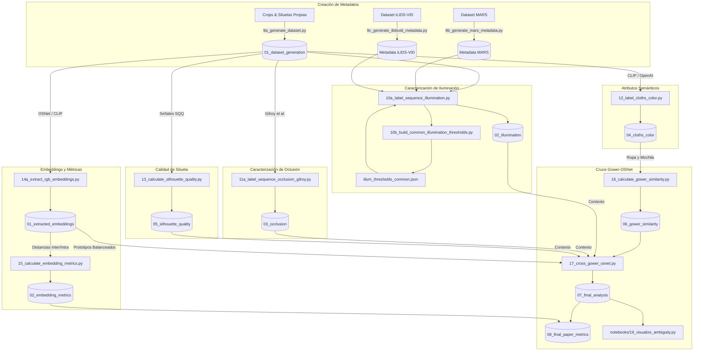

# Flujo de Creación de CSVs y Pipeline de Agregaciones

Este documento detalla el flujo de datos y metadatos para la caracterización del corpus, incluyendo iluminación, oclusión, calidad de silueta, extracción de atributos semánticos, embeddings RGB, el cruce de ambigüedad visual-semántica y la organización final de los CSVs generados.

---

## 1. Mapa General del Pipeline de Metadatos

El siguiente diagrama muestra cómo fluyen los datos a través de los diferentes scripts (renombrados en la carpeta `src/`) y cómo se estructuran jerárquica y secuencialmente las salidas en `dataset/output/`:

---

## 2. Organización de Salidas (`dataset/output/`)

Los archivos CSV resultantes han sido organizados en directorios numerados para representar el orden en el que fueron generados y facilitar la localización de los datos.

### A. Subcarpetas en `dataset/output/metadata/`

#### 📂 `01_dataset_generation/` (Generadas por `9a_generate_dataset.py`)
* **Uso:** Agrupación inicial de tracklets en ciclos de marcha usando sumas de primer plano.
* **Archivos:**
  * `gait_cycles.csv` (alias: `sequences.csv`)
  * `gait_cycle_frames.csv` (alias: `sequence_frames.csv`)
  * `skipped_tracklets.csv`
* **Esquema de Columnas Principal (`gait_cycles.csv`):**
  * `sequence_id` (o `cycle_id`): Identificador único de secuencia (ej. `S01_c001_ID0000_cyc0001`).
  * `person_global_id`: ID global del peatón.
  * `scene_id`: Escena de captura (ej. `S01`).
  * `cam_id`: Cámara de procedencia (ej. `c001`).
  * `tracklet_index`: Índice del tracklet original.
  * `cycle_index`: Índice ordinal del ciclo detectado.
  * `num_frames`: Número de fotogramas del ciclo.
  * `frame_start` / `frame_end`: Fotograma inicial y final de la secuencia.
  * `frame_gap_max`: Salto de fotograma máximo detectado.
  * `temporal_continuity_ratio`: Continuidad temporal del ciclo ($[0,1]$).
  * `bbox_h_median` / `bbox_w_median` / `bbox_area_mean`: Métricas físicas del cuadro delimitador.
  * `estimated_step_period` ($T_i$): Periodo de paso dominante estimado por autocorrelación.
  * `estimated_cycle_length` ($L_i^{cycle}$): Ciclo completo de marcha estimado ($2T_i$).
  * `periodicity_score`: Puntuación de periodicidad de autocorrelación.
  * `foreground_sum_mean`: Área media del primer plano.
* **Esquema de Columnas (`gait_cycle_frames.csv`):**
  * `sequence_id`, `position_in_cycle`, `frame_number`.
  * `rgb_source_path` / `silhouette_source_path`: Rutas originales de los recortes de imágenes y siluetas.
  * `rgb_output_path` / `silhouette_output_path`: Ubicaciones físicas materializadas.
  * `bbox_x`, `bbox_y`, `bbox_w`, `bbox_h`: Coordenadas específicas del cuadro delimitador.

#### 📂 `02_illumination/` (Generadas por `10a_label_sequence_illumination.py` y `10b_build_common_illumination_thresholds.py`)
* **Uso:** Calibración y etiquetado ordinal de iluminación (baja, medio-baja, medio-alta, alta) mediante luminancia media BT.601.
* **Archivos:**
  * `sequences_illumination.csv`
  * `sequences_labeled_raw.csv`
  * `illum_thresholds_common.json`
* **Esquema de Columnas (`sequences_illumination.csv`):**
  * `sequence_id`, `person_global_id`, `scene_id`, `cam_id`
  * `illum_y_mean`: Luminancia promedio temporal BT.601 de la secuencia.
  * `illum_y_std`: Desviación estándar temporal de la luminancia.
  * `illum_y_cv`: Coeficiente de variación temporal ($CV_{Y_i}$).
  * `illum_level`: ID ordinal de iluminación ($0$: baja, $1$: media-baja, $2$: media-alta, $3$: alta).
  * `illum_label`: Etiqueta textual del nivel de iluminación.
  * `illum_percentile_bin`: Categoría de percentil de calibración común (`Q1`-`Q4`).

#### 📂 `03_occlusion/` (Generadas por `11a_label_sequence_occlusion_gilroy.py` y shards consolidadores)
* **Uso:** Estimación objetiva del porcentaje de oclusión de peatones a nivel frame y secuencia usando 17 keypoints corporales de Detectron2.
* **Archivos:**
  * `gait_cycles_occlusion.csv`
  * `gait_cycle_frames_occlusion.csv`
  * `gait_cycles_occlusion_shard_x_3.csv` / `gait_cycle_frames_occlusion_shard_x_3.csv`
* **Esquema de Columnas (`gait_cycles_occlusion.csv`):**
  * `sequence_id`, `person_global_id`, `scene_id`, `cam_id`
  * `occlusion_pct_mean`: Porcentaje promedio de oclusión estimado para la secuencia.
  * `visible_keypoint_ratio_mean`: Ratio medio de keypoints visibles.
  * `valid_pose_ratio`: Ratio de frames con estimación de esqueleto válida.
  * `occlusion_level`: Nivel ordinal ($0$: baja, $1$: parcial, $2$: intensa).
  * `occlusion_label`: Etiqueta de oclusión (`baja_oclusion`, `oclusion_parcial`, `oclusion_intensa`).

#### 📂 `04_cloths_color/` (Generadas por `12_label_cloths_color.py`)
* **Uso:** Extracción y acuerdo mayoritario de atributos discretos de apariencia (ropa superior, inferior, colores y mochila).
* **Archivos:**
  * `sequence_visual_attributes.csv`
  * `identity_visual_attributes_pair_ready.csv` (Consolidado por sesión de identidad)
  * `visual_attribute_sampled_frames.csv`
  * `visual_attributes_manual_review.csv`
  * `pair_feature_schema.json`
  * `visual_attributes_cache.jsonl`
* **Esquema de Columnas (`identity_visual_attributes_pair_ready.csv`):**
  * `person_global_id`: ID de identidad consolidada.
  * `capture_session_id`: ID de la sesión de captura (agrupación de constancia de vestimenta).
  * `upper_garment_type` / `lower_garment_type`: Tipo de prenda estimado (ej. `polera`, `pantalon_largo`).
  * `upper_color_label` / `lower_color_label`: Color dominante (ej. `negro`, `azul`, `blanco`).
  * `backpack_flag`: Indicador binario de mochila ($1$: sí, $0$: no, vacío: desconocido).
  * Atributos de consenso (`consensus_ratio`): Nivel de acuerdo temporal en la secuencia.

#### 📂 `05_silhouette_quality/` (Generadas por `13_calculate_silhouette_quality.py`)
* **Uso:** Caracterización de estabilidad morfológica, calidad de la marcha estructurada y ventanas degradadas.
* **Archivos:**
  * `gait_cycles_quality.csv`
  * `gait_cycle_frames_quality.csv`
  * `gait_cycles_sqq_windows.csv`
  * `silhouette_quality_report.txt`
* **Esquema de Columnas (`gait_cycles_quality.csv`):**
  * `sequence_id`, `person_global_id`, `scene_id`, `cam_id`
  * `sqq_quality_ratio_mean` ($Q_i$): Calidad media de la silueta en ventanas deslizantes (marcha estructurada vs ruido).
  * `sqq_quality_ratio_std`: Desviación estándar de la calidad de silueta.
  * `sqq_degraded_ratio`: Ratio de ventanas detectadas por debajo del umbral de calidad $\tau_Q$.
  * `mca_ratio_mean` (MCA): Porcentaje del área conectada más grande en el primer plano.
  * `silhouette_valid_ratio`: Fracción de siluetas con morfología humana aceptable.

#### 📂 `06_gower_similarity/` (Generadas por `16_calculate_gower_similarity.py`)
* **Uso:** Comparación combinada semántica de prendas de vestir mediante coeficiente de Gower para los 2,701 pares de identidad.
* **Archivos:**
  * `gower_identity_pairs.csv`
  * `gower_hard_identity_pairs.csv`
  * `gower_identity_summary.csv`
  * `gower_identity_distance_matrix.csv`
  * `gower_identity_similarity_matrix.csv`
* **Esquema de Columnas (`gower_identity_pairs.csv`):**
  * `person_id_a` / `person_id_b`: IDs de las dos identidades comparadas.
  * `session_id_a` / `session_id_b`: IDs de sesiones respectivas.
  * `gower_similarity` ($S^{Gower}_{xy}$): Coeficiente de similitud de Gower ($[0,1]$).
  * `gower_distance`: Distancia semántica por pares ($1 - S_{xy}$).
  * `n_valid_attributes`: Número de atributos evaluables y válidos en común ($n \ge 4$).
  * Indicadores de pares (e.g. `same_upper_garment`, `same_lower_garment`, `same_upper_color`, `same_lower_color`, `both_backpack`, `both_no_backpack`).

#### 📂 `07_final_analysis/` (Generadas por `17_cross_gower_osnet.py`)
* **Uso:** Cruce híbrido de distancia visual (OSNet) y semántica (Gower) con variables de contexto físico para el análisis de ambigüedad.
* **Archivos:**
  * `gower_osnet_cross_analysis.csv`
  * `confirmed_ambiguous_identity_pairs.csv`
  * `unexplained_visual_ambiguity_pairs.csv`
  * `gower_osnet_ambiguity_summary.csv`
* **Esquema de Columnas (`gower_osnet_cross_analysis.csv`):**
  * `person_id_a` / `person_id_b`: Identidades en comparación.
  * `gower_similarity`: Similitud semántica discreta de vestuario.
  * `osnet_similarity`: Similitud visual continua de OSNet (producto escalar de prototipos de identidad equilibrados por cámara).
  * `ambiguity_quadrant`: Identificador del cuadrante de ambigüedad ($1$: Ambiguidad confirmada, $2$: Ambiguidad visual inexplicable, $3$: Similitud semántica controlable, $4$: Baja ambigüedad).
  * `max_heavy_occlusion_ratio`: Oclusión más alta presente en las identidades del par.
  * `max_low_illumination_ratio`: Luminancia mínima/baja iluminación compartida.
  * `max_degraded_silhouette_ratio`: Nivel de degradación de siluetas en el par.
  * `adversity_score`: Puntuación de adversidad ambiental compuesta.

#### 📂 `08_final_paper_metrics/` (Carpeta consolidada de resultados para el manuscrito)
* **Uso:** Almacena copias exactas de los CSVs finales que se utilizan para reportar las métricas de separabilidad del artículo y graficar la ambigüedad en los cuadrantes. Evita tener que buscar los resultados entre carpetas intermedias.
* **Archivos copiados en este directorio:**
  * `gower_osnet_cross_analysis.csv`
  * `confirmed_ambiguous_identity_pairs.csv` (Los 90 pares de ambigüedad confirmada de la Fig. 7)
  * `unexplained_visual_ambiguity_pairs.csv` (Los 181 pares con ambigüedad inexplicable)
  * `gower_osnet_ambiguity_summary.csv` (Resumen de cuadrantes de la Fig. 5)
  * `dataset_embedding_ambiguity_summary_osnet.csv` (Separabilidad global y cruzada entre cámaras de la Tabla 4 del paper)
  * `dataset_embedding_ambiguity_summary_clip.csv` (Separabilidad global y cruzada de CLIP)

---

### B. Subcarpetas en `dataset/output/embeddings/`

#### 📂 `01_extracted_embeddings/` (Generadas por `14a_extract_rgb_embeddings.py`)
* **Uso:** Extracción de embeddings numéricos profundos a nivel de secuencia mediante arquitecturas OSNet y CLIP.
* **Archivos:**
  * `sequence_embeddings_osnet.csv`
  * `sequence_embeddings_clip.csv`
* **Esquema de Columnas (`sequence_embeddings_osnet.csv`):**
  * `sequence_id`, `person_global_id`, `scene_id`, `cam_id`
  * `embedding_json`: Array JSON con los valores numéricos del vector continuo de 512 dimensiones normalizado L2.
  * `n_frames_extracted`: Número de frames procesados para promediar la secuencia.

#### 📂 `02_embedding_metrics/` (Generadas por `15_calculate_embedding_metrics.py`)
* **Uso:** Evaluación macro y cálculo de métricas de separabilidad intraclase/interclase globales y entre cámaras.
* **Archivos:**
  * `dataset_embedding_hard_pairs_osnet.csv` / `dataset_embedding_hard_pairs_clip.csv`
  * `dataset_embedding_ambiguity_summary_osnet.csv` / `dataset_embedding_ambiguity_summary_clip.csv`
* **Esquema de Columnas (`dataset_embedding_ambiguity_summary_osnet.csv`):**
  * `dataset`: Nombre del benchmark (`mi_corpus`, `mars`, `ilidsvid`).
  * `mean_intra_dist`: Distancia media coseno intraclase (misma persona).
  * `mean_inter_dist`: Distancia media coseno interclase (distintas personas).
  * `separability_ratio`: Ratio de separabilidad global ($R_{sep}$).
  * `mean_intra_crosscam_dist`: Distancia media intraclase evaluando exclusivamente cámaras diferentes.
  * `mean_inter_crosscam_dist`: Distancia media interclase evaluando exclusivamente cámaras diferentes.
  * `crosscam_separability_ratio`: Ratio de separabilidad operativa de cámara cruzada.
